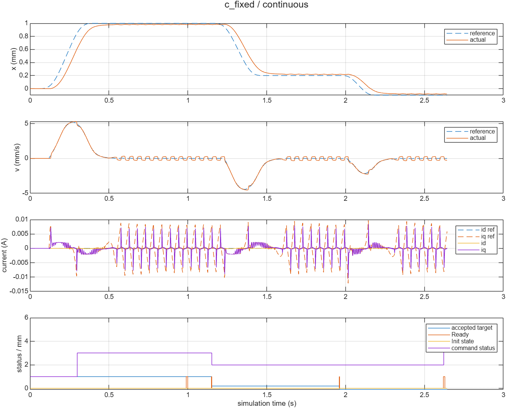
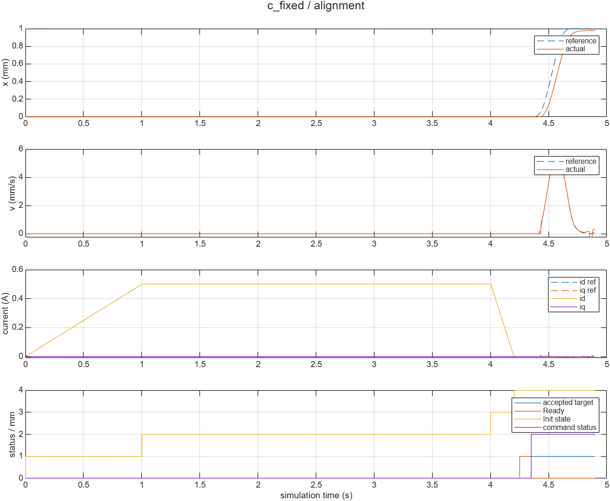
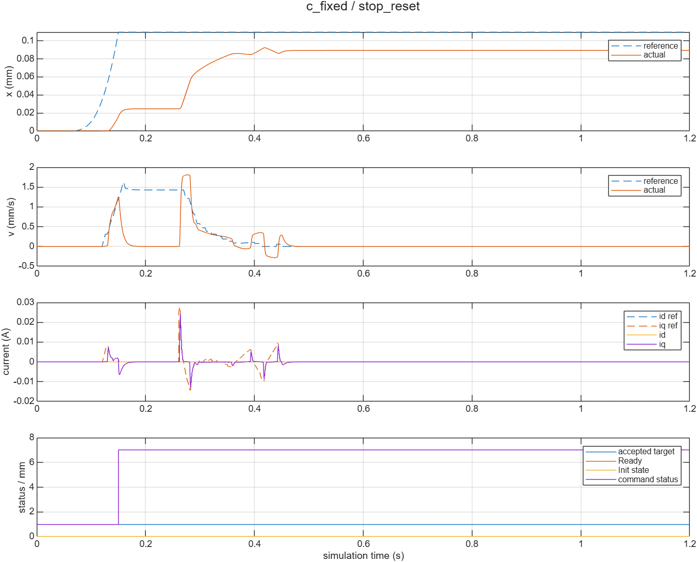

# AX-01B：Runtime生成C与p3反馈闭环

仓库：`kazecode666/AXU5EV`；本地：`D:/Project/AXU5EV`；目标：AXU5EVB-E。接续已合并PR #5及任务PR #6，基于main `88528d7eb0ce517fc31e624940d513286ec0289e`。执行日期2026-10-26。

**当前记录仍在执行：真实RTL长场景正在运行，不能据下表宣布整轮完成。** 最终Review交付前补齐实际RTL点位／连续目标结果；长对齐如未完成，单列未完成，不以参考回放替代。

## 实现

- 新`AXU5EV_R5_Runtime.slx`直接纳入原Host_Core及原点位/S曲线函数，复用PR5 Motion_Control／Alignment_Task。20字段输入、41字段提交、100µs软件拍；原1ms速度、10ms位置首相不变。
- 薄C MEX每软件拍调用一次生成step；新Run初始化、暂停保持。生成C未手改；这是Windows生成C主机反馈闭环，不是托管SIL或R5实机。
- 同一个`AXU5EV_Hybrid_ClosedLoop.slx`选择模型＋定点FOC、C＋定点FOC、C＋真实p3 XSI。原电机／逆变器继续反馈，面板只传命令，没有PC轨迹或外环旁路。
- 同一Convergent／Saturate量化边界；p3九字段整帧锁存，50MHz完整5000拍，post314结果在外寄存器edge315捕获，状态保持可读。40位完整传输，duty按2^-30还原。
- 共用一次50µs function-call应用；移除原PWM更新子系统的ZOH＋UnitDelay，保留0.5初值和原一次平均死区。实际PWM禁止作用于逆变器施加电压，机械模型继续演化。

输入／输出索引、执行顺序和复位关系见[接口](../../integration/ps_pl/INTERFACE.md)；构建、Run、目标草稿／Send、手动对齐及重生成规则见[操作指南](../../docs/AXU5EV_HYBRID_RUN_GUIDE_ZH.md)。

## 已完成的模型与生成C结果

模型版和C版四组场景已实际运行，使用原参数，正常场景仅通过面板绑定的命令入口修改1mm目标和仿真时长。默认初始化10mm／5s／V10／A100未改。

| 场景 | 实际结果 |
|---|---|
| 1mm／1.2s | 最后记录帧1.1999s，x=0.981298983353mm；Ready=1，接受1，拒绝0 |
| 同次Run连续目标 | 接受1→0.2→-0.1mm，含反向；Busy发送拒绝1次，不排队；重复目标status5、segment_id仍3 |
| 物理对齐后运动 | 手动Start=0.002s；RAMP_ID10000／HOLD_ALIGN30000／RAMP_DOWN_ID2000拍；4.202s进入DONE，随后发送1mm，4.9s位置约0.9833mm |
| PWM／PI／Init／已有故障入口 | PWM禁止时vd/vq施加值均0；0.15→0.26s位置0.01623718→0.02465321mm，机械继续；故障人工清除后接受数仍1，中断=1，Busy=0 |

连续场景原Ready条件首次出现于0.9899／1.9599／2.6199s，相应目标位置误差为0.01949259／-0.01934982／-0.01988575mm，均在原0.02mm窗内。场景脚本在暂停点观察Ready后才发送，因此实际接受0.2mm和-0.1mm的时刻为1.1511s和1.9621s；重复确认2.6231s。Ready会受原闭环纹波影响，最终暂停时Ready可回到0；没有放宽到位窗或用轨迹完成替代到位。

同输入核对使用实际闭环记录的20字段快照重跑Runtime参考，并用实际FOC九字段核对固定FOC。四组软件最大绝对差：点位／连续／对齐2.2204e-16，启停8.6736e-19，均小于1e-12；相应RMS为3.166e-19／3.028e-19／2.382e-19／1.237e-21。所有三相duty字差为0。四组模型版与C版在共同时间区间的x/v/id/iq及施加duty最大／RMS差均为0，见[逐信号表](../../verification/ax01b/closedloop_differences.csv)。

四组波形中，三相`duty_applied`与对应本帧`duty_result`字差均0，应用时间为本帧采样时间＋50µs，最大时间误差1.166e-16s。没有用平移曲线掩盖附加帧／半帧延迟。

## 实际RTL结果（其余场景运行中）

XSI DLL已由原p3 SV与两个外围模块构建，独立MATLAB进程中实际运行C＋RTL＋原电机反馈。标准点位已完成12000帧，1.1999s记录x=0.981298983353mm、Ready=1。全部实际RTL duty与同输入定点参考字差0；全部帧号连续，捕获315、有效=1、hold_violation=0；同帧50µs应用字差0。x/v/id/iq及施加duty与C＋定点版最大／RMS差均0。

连续目标、长对齐和启停场景仍在实际运行，完成后补入完整结果，不能以点位通过代替这些场景。精简结果见[场景表](../../verification/ax01b/scene_results.csv)、[同输入与应用核对](../../verification/ax01b/same_input_comparisons.csv)及[命令／对齐事件](../../verification/ax01b/command_events.csv)。

额外MATLAB进程无法同时取得Motor Control Blockset许可，已将定点参考观察器移出真实RTL分支。实际反馈链由C和XSI运行；完成后在持有许可的主会话对记录输入运行独立参考。参考回放仅为数值比较，不驱动RTL反馈链。

点位完成后，早期已加载的旧prepare缓存曾触发重复构建，因其它运行占用MEX而失败；完整点位结果已保留，启停改用加载当前入口的新进程运行。当前入口仅在缺少产物或明确`rebuild=true`时构建，普通Run不会因排版保存而重编译。

## 模型检查与保留

新Runtime、共享闭环及同输入参考模型的连线／悬空端口／Stateflow检查均healthy。新模型Goto均局部作用域，Inport／Outport均30×14默认大小。已查看顶层、Runtime字段列、Variant、量化和50µs应用层的渲染，采用局部方括号标签和正交短线；原控制子系统内部布局保留。另一次独立只读源码／SLX审查未发现控制或帧时序问题；该审查未运行MATLAB，不能当作额外复跑证据，也不替代本PR的Review。

用户原有`AXU5EV_R5_Control.slx`、`AXU5EV_R5_Reference.slx`修改及未跟踪wrapper未保存、覆盖或纳入本PR。Runtime以PR5已提交来源建立独立新模型。

## 验证层级和下一步

| 层级 | 本轮状态 |
|---|---|
| 导入／静态核对／新模型连线排版 | 已执行 |
| 主机生成C在线闭环及同输入比较 | 已执行；不是托管SIL |
| 真实p3 RTL反馈联合仿真 | RUNNING，待写入最终场景结果 |
| 新5EV综合／布线／ARM目标编译／R5周期与WCET | NOT_RUN |
| 真实AXI／CDC／ADC／位置接收／门极与保护板级适配 | NOT_RUN |
| 下载bitstream／功率级上电／实机 | NOT_RUN |

完整MAT波形及工具缓存保留`.runtime/ax01b/`，仅精选小表、曲线和事件日志入库。下一轮仍需实际R5F standalone平台与PS—PL访问、板级接口、时限及5EV实现验证。本轮不自动合并或上板。
