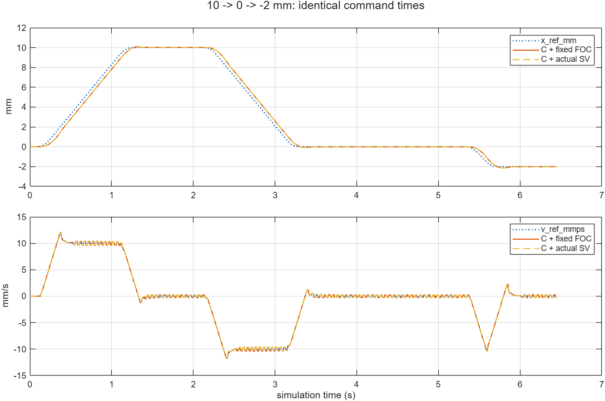
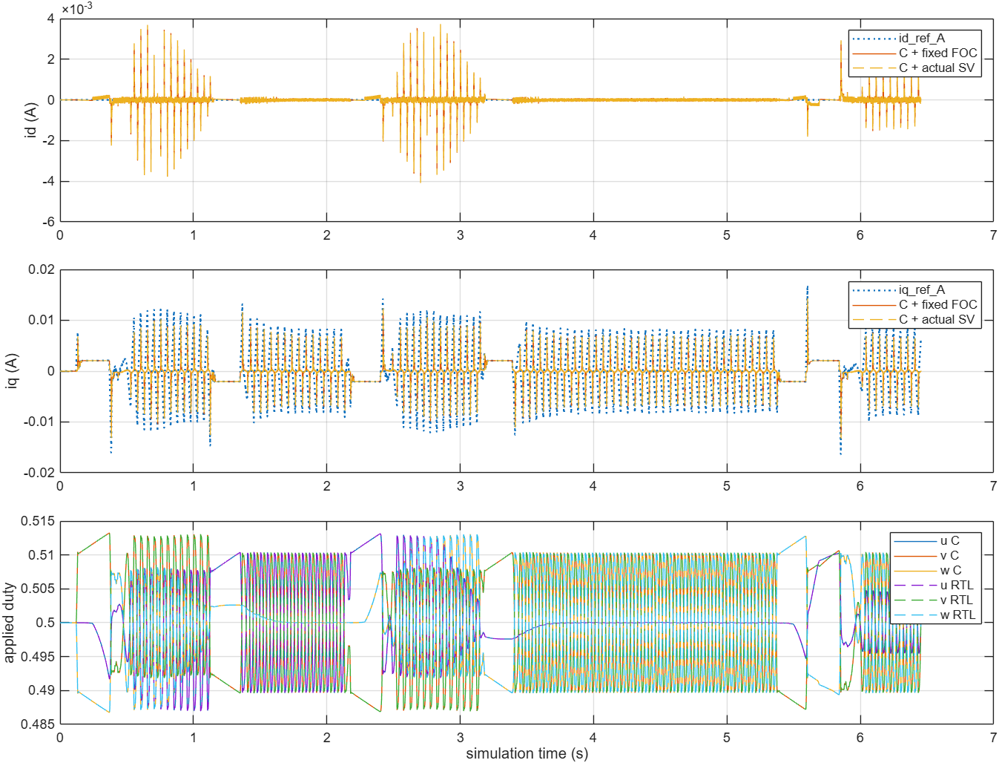

# AX-01C：完整C/RTL运动与模块搭建说明

仓库`kazecode666/AXU5EV`，本地`D:/Project/AXU5EV`，日期2026-10-27。执行[Issue #13最新正文](https://github.com/kazecode666/AXU5EV/issues/13)，基于PR #12合并提交`22c783d57a8ed43773efa2c986f2d5dab9731852`。取消原C源码学习与教学配置任务，不实施Issue #11或板级工作。

## 必要小修与实际运行条件

- `axu5ev_run_case.m`在保存前创建自己的`.runtime/issue8/`输出目录，修复干净环境下仅因目录缺失而保存失败的问题。
- 唯一日常入口仍为`simulation/START_HERE.m`和`init_AXU5EV.m`；默认10 mm、V10/A100/J1000及全部PI/原时基不改。用户已保存的Hybrid StopTime=6 s保留；收尾场景只用SimulationInput设置本次6.4536 s。
- 从PR7旧20字段顺序升级须显式重建Runtime C MEX一次，PR9已完成；本轮核对实际加载的`.runtime/ax01b/ax01b_r5_sfun.mexw64`及当前位置20、速度15生成来源，普通Run/排版不重复编译。不手改生成C/SV，不新增哈希或监控。
- 回执中的Ready/Busy明确为该拍请求处理后的当前提交；保留原判断与拒绝不排队，不重查已有证据的拒绝问题。鼠标/键盘与显示刷新仍NOT_RUN，独立于离线闭环验收。

## 同一组命令与结果

复用既有continuous顺序：自动首段10 mm，返回0，运动中11 mm请求被拒绝，再反向−2 mm。`axu5ev_closeout_run`让两后端按本轮C实际记录的采样时刻2.0915、2.1016、5.2999 s发送相同草稿与翻转位；暂停调参放在采样拍前5 µs，避免浮点暂停端点越过该拍。用实际20字段记录核对两次Run的命令和采样时刻，而非各自等待Ready后再发送。

C基准实际完成64536帧，接受3（含自动首段）/拒绝1/段号3，三段分别在1.9199、3.9599、6.3499 s首次Ready。末拍Ready可因原窗口再次回落，不把强制末拍为1作为验收；每段必须实际满足原Ready规则。

真实RTL已实际完成同一组64536帧，每帧完整5000拍，合计322680000个运行时钟拍。使用原SystemVerilog的XSI反馈链，非定点参考回放驱动。全部帧号连续，capture_edge=315、result_valid=1、hold_violation=0。主机RTL墙钟15527.072198 s（约4小时19分钟），只表示这次PC功能联合仿真耗时，不是R5任务时间。

| 核对项 | 实际结果 |
|---|---|
| 命令输入与采样时刻 | 两后端所有帧的命令/replay/对齐/故障字段完全相同；三次采集均为2.0915、2.1016、5.2999 s，status分别2、3、2 |
| 接受/拒绝与状态 | 含自动首段接受3、拒绝1、段号3、中断0；11 mm Busy请求拒绝且不排队；24–36字段逐拍相同 |
| 完整41字段提交 | 两后端最大绝对差0 |
| 位置/速度/dq电流及四项参考 | 11项逐信号表中的最大差/RMS均0（含三相应用duty）；统计使用完整原始记录 |
| FOC输出与应用duty | 全部帧三相结果字差0，应用字差0；同帧+50 µs应用最大时间误差1.1653e−16 s |
| 反馈快照 | 位置字段20、速度字段15均与同拍真实反馈一致，误差0；原Host逐拍复算与实际提交一致 |
| 静态与图像 | 3份相关.m的Code Analyzer均0问题；已检查两幅实际运动/FOC曲线及两幅原SLX局部图 |

两后端的首次到位结果完全相同，五次位置事件均在原0.02 mm窗口内：

| 段/目标 | 首次Ready仿真秒 | 五事件最大绝对误差mm |
|---|---|---|
| 1 / 10 mm | 1.9199 | 0.0198734956174 |
| 2 / 0 mm | 3.9599 | 0.0195199227385 |
| 3 / −2 mm | 6.3499 | 0.0196284307461 |

最后记录帧6.4535 s，位置−2.01866317927111 mm，Busy=0、Ready=0；两后端相同。该末拍Ready回落不取消已经发生的到位事件，没有改窗口或强制Ready。记录位置最大10.0783297974089 mm、最小−2.14687543159648 mm，记录峰值速度12.1113293046322 mm/s。图保留完整数量级、时间关系和原闭环纹波，没有平移或缩目标。

精简证据：[运行结果](../../verification/ax01c/run_results.csv)、[逐信号差异](../../verification/ax01c/differences.csv)、[C命令](../../verification/ax01c/c_fixed_commands.csv)、[RTL命令](../../verification/ax01c/c_rtl_commands.csv)、[到位事件](../../verification/ax01c/ready_events.csv)、[10 ms运动曲线](../../verification/ax01c/motion.csv)、[应用duty](../../verification/ax01c/applied_duty.csv)。完整MAT及日志留`.runtime/ax01c/`。

## 实际执行说明

新增`axu5ev_closeout_run`复用既有运动顺序，以本轮C记录的实际采样时刻驱动两后端。初次脚本在暂停端点附近出现一拍偏移，保留了实际C原始记录，并以其实际采样时刻统一重放RTL；只调整复验脚本的调参暂停点，没有改控制或物理时序。当前脚本提前5 µs调参，之后以实际快照核对命令时刻。初次脚本要求末拍Ready=1的断言也改为逐段实际出现Ready，符合原规则。

RTL请求超过MCP的600秒单次等待上限后，MATLAB继续执行。未重启或重复启动RTL；后台完成后读取完整MAT中的events/checks并完成后处理。导出按各物理日志自己的Time取得R5同拍值，最大差/RMS仍用完整原始样本，不依赖记录行号或抽取率。旧model_fixed/C结果引用PR9/PR12，不重跑旧复位/对齐等无关工况。既有Inherit与定点量化警告保留。

## 模块说明与复用边界

[运行说明新增短节](../../simulation/README_运行说明.md#模块怎样组成闭环)按本地SLX核对Mux与采样、两个Variant Subsystem、Runtime Host/Alignment_Task/Motion_Control、Function-Call Generator及计数链、41字段与Alignment_Interface、FOC和50 µs应用/1 µs对象，并附R5选择区与调度局部图。紫色分区保留，不为讲解改变执行语义或重构模型。

当前是Windows PC执行生成C的MEX与实际SystemVerilog反馈联合仿真，包含原机械/逆变器对象；没有真实R5、指令集/周期精确处理器模型或实际AXI。模型名称与f()不构成R5硬件中断。未来R5替换PC软件执行环境，电机对象与Dashboard仍属于仿真端。

托管SIL/PIL、R5目标程序/BSP/任务时间、真实PS—PL/AXI、5EV综合/布线、ADC/编码器/A53、ARM实测、烧录和实机均NOT_RUN。不自动合并或上电。
