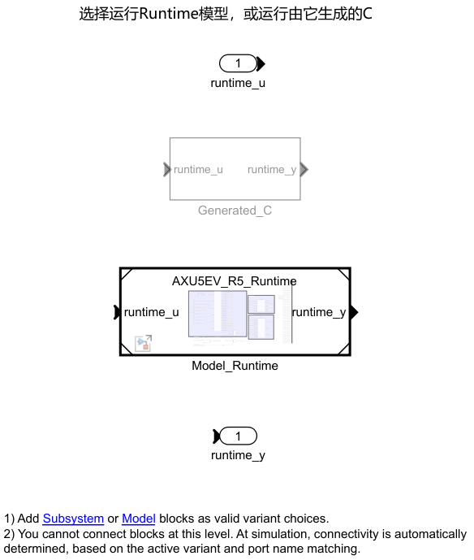
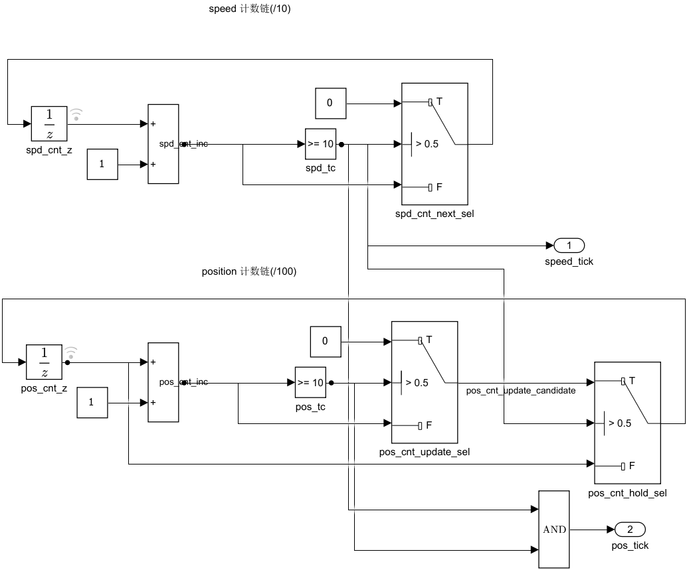

# 日常仿真：从这里开始

## Issue40 无功率自动通路

当前ADC/QEP→电流/电角度→原FOC→PWM比较值的统一入口为 [`motor_control/AXU5EV_Motor_Control_System.slx`](motor_control/AXU5EV_Motor_Control_System.slx)，通过 `motor_control_run(<新结果目录>)` 实际运行。它复用原组件和FOC，包含R5位置/测速旁路，外设接口和谷值显示明确为SIM_ONLY。运行器隔离原已接受依赖，保护本地修改的ADC/共享库/Hybrid和交互参数；不要为运行此任务执行旧初始化或保存用户模型。具体命令、帧对齐与生成来源见 [motor_control模型说明](motor_control/README.md)。本轮完整外环、Runtime和自动对齐未接实时反馈。

## 原完整闭环日常入口

进入 `simulation/`，按需编辑 **init_AXU5EV.m**，运行 **START_HERE.m**。入口按自身位置加载参数、准备所选后端并打开 **AXU5EV_Hybrid_ClosedLoop**，不自动Run。默认保留 **model_fixed、10 mm、5 s、V10/A100/J1000**。

## 正常点位与同次Run继续发送

1. 以命令行 `AXU5EV_READY backend=...` 确认准备后端。Run后面板Backend显示0=model_fixed、1=c_fixed、2=c_rtl；停止时数字显示可能保留上一Run。AutoStart=1自动发起首段，status=1不是故障。
2. 观察 `x_ref_mm`、`x_mm` 和Ready。Ready需轨迹完成、误差不超过0.02 mm、连续5个位置事件，并同时满足模式、PWM、复位和对齐条件。它按10 ms位置事件更新，事件间机械仍会运动；不能按现实等待了几秒判断。
3. Ready=1后，在 `Set_Host_Target_mm` 输入下一草稿目标，按Enter确认，再将 **Send_Move_Toggle** 翻转一次。0→1、1→0各算一次请求；只改草稿不会启动运动。Ready是R5当拍许可，显示过1不保证下一采样拍仍为1；Busy=0也不等于Ready=1。
4. 看右侧 `R5_Command_Receipt` 的接收时间、status和计数确认结果。status=2、接受数/段号增加才表示新段接受。当拍未Ready为3（包括Busy=0但未满足到位条件），当前模式/PWM/复位/对齐不允许为6；两者均拒绝、不排队。同目标为5，不新起段。拒绝后须等待Ready并再次翻转Send；仅等Ready恢复不会补发。status通常保留最近请求结果，但运动中PWM禁止或PI_Reset会异步改为7（中断），此时接收秒不更新，不表示收到新请求。

右侧新增两个只读显示，均取自同次100 µs输入/提交，按从上到下读取：

| 显示 | 行顺序 |
|---|---|
| `R5_Sampled_Send_Ready_Busy` | R5实际采样Send、当前提交的Ready、当前提交的Busy（均为该拍请求处理后） |
| `R5_Command_Receipt` | 最近请求接收软件秒、Host状态、累计接受数、累计拒绝数、段号、接受目标mm |

接收时间更新且拒绝数增加，表示请求已采集并拒绝；不应误判为Send失效。初始status=1、接受数/段号=1是自动首段，接收秒初值0。快速连续翻转两次若都发生在相邻100 µs采样之间，可能抵消；每次翻转后先确认回执再操作。显示用于观察，不锁存Ready或改变接收条件。

也可点击Pause后修改目标并确认，再翻转Send，点击Continue。暂停继续不会重置控制/轨迹状态；暂停看到的是已提交状态，继续后的采样拍仍会按原位置事件重新判断Ready，因此也必须查看回执。仿真结束前需留足运动时间；停止后修改 `init_AXU5EV.m` 的 `M1A_StopTime_s` 并重新运行START_HERE，或只在模型工具栏延长本次StopTime。Pacing只影响交互节奏，不修正控制问题。

Dashboard绑定已通过MCP检查；本轮不使用Computer Use，输入框按键、实际鼠标翻转及显示刷新尚未亲手操作，记为 **UI手动验证NOT_RUN**。最短人工核验：按上述路径完成10 mm，Ready后输入0并按Enter，翻转Send，先确认采样Send、接收秒及回执；若3/6拒绝，等条件满足后再次翻转。接受目标变0且电机返回后，再输入−2确认并反向翻转Send。若草稿没变，先核对输入是否确认。

## 参数、运行输入与重建

| 类别 | 修改方式 |
|---|---|
| 目标草稿、Send、速度/id/iq测试请求、PWM请求、PI_Reset、手动Init_Start/Init_Reset | 通过现有面板运行输入修改，无需生成C；模式组合须有效 |
| backend、Alignment_Enable | 停止后设置；backend在init中选定后运行START_HERE，或在已初始化状态调用 `axu5ev_prepare('c_fixed')` |
| 电机参数、时基、PI/限幅、轨迹配置、对齐拍数等 | 停止后编辑唯一init并初始化；编入C的参数改变后必须显式重建；不改变既定时序合同 |
| 纯区域/注释/排版 | 无需重生成C；Control、Runtime、Hybrid布局分别保留 |

普通Run不重新编译。首次C/RTL模式会构建缺少的产物；已有MEX不会因工作区参数变化而自动更新。修改Runtime算法、输入向量顺序或编入C的参数后，停止并执行：

```matlab
axu5ev_prepare('c_fixed',true); % 或c_rtl；使用当前已初始化参数，不恢复默认目标
```

**从PR7旧映射升级时，必须显式重建一次Runtime的C MEX。** 20字段总宽度没变，旧MEX仍可能加载，但位置/速度会读错；不能只重接SLX继续使用旧产物。PR9已执行该重建，本轮使用的本机MEX为`.runtime/ax01b/ax01b_r5_sfun.mexw64`，并核对其实际闭环输入/提交。普通查看、排版、Run或切换到已有c_rtl不重复重建。

不要在另一个MATLAB正在使用相同MEX/DLL时重建。Vivado路径只在init中的 `AX01B_Vivado_Root` 设置。完整缓存、MEX、XSI及生成工程在仓库 `.runtime/ax01b/`。仅切换后端或查看模型不应重复运行初始化；**START_HERE明确重新加载文件中的参数，不能在运行/暂停中使用它刷新面板**。

## 手动对齐与各类复位

停止时设置 `Alignment_Enable=1`，`Init_Start=0`、`Init_Reset=0`。在允许电流调节的状态Run后，手动Start=1；观察原五态及Init_Done，完成后Start=0，Alignment_Enable保持启用以继续应用已取得偏置，Ready后再发送目标。保持RAMP_ID 10000拍、HOLD_ALIGN 30000拍、RAMP_DOWN_ID 2000拍、0.5 A；以100 µs仿真拍计约4.2 s。Alignment_Enable=0是旁路，不自动对齐；软件AutoStart与手动对齐Start不是同一输入。

PI_Reset是原控制复位请求，不能当运动启停按钮；有效复位仍受PWM禁止和对齐故障条件影响。PWM请求禁止逆变器输出，但机械模型继续运动。Init_Reset只复位原对齐；全局新Run、PI_Reset、Init_Reset和故障清除分别处理。原运动中断后保持参考、拒绝自动续段；清故障或释放PI_Reset不自动恢复原段。需要全新首段时Stop后新Run，不新增恢复框架。

## 三个模型的角色与区域

| 模型 | 用途 |
|---|---|
| Hybrid_ClosedLoop | 日常Run的完整反馈闭环，含电机/逆变器和操作面板 |
| R5_Runtime | Host/命令/轨迹、外环、原对齐的C代码生成入口；需顶层输入，不是独立电机闭环 |
| R5_Control | PR5组件来源，供研究与对照；其子系统曾复制进Runtime，二者没有自动同步的引用关系 |

保持原紫色分区：操作面板；轨迹/外环/参考管理/原对齐；100 µs调用与帧提交/50 µs应用；原逆变器/电机1 µs对象；Alignment_Interface；Motor_Control_Monitor。Runtime保留Host、Alignment_Task、Motion_Control。视觉区域不构成新的执行边界。

Hybrid输入Mux与Runtime的Demux均为分组宽度 `[11 3 1 1 1 1 1 1]`：**1:11命令，12:14 replay，15速度mm/s，16对齐使能，17 Start，18 Init_Reset，19故障，20位置mm**。前两路仍为向量，端口号不等于字段索引；两端有旁注。输出41字段保持原顺序，详见[接口](../integration/ps_pl/INTERFACE.md)。

SDI直接使用 `draft_target_mm`、`accepted_target_mm`、`x_ref_mm`、`x_mm`、`position_error_mm`、`v_ref_mmps/v_mmps`、`id_ref_A/id`、`iq_ref_A/iq`、`Ready/Busy/command_status`、`send_toggle`、`pi_reset_request/effective_reset`；面板同时显示backend与仿真时间。不要把草稿目标、接受目标与轨迹参考混作一条信号。

### 模块怎样组成闭环

当前用PC执行“未来归R5的软件功能”，没有真实R5、指令集或周期精确处理器模型。Runtime、f()和MEX均不是R5处理器仿真器；20/41字段也不是已实现的AXI。将来替换的是PC软件执行环境，电机对象和Dashboard不搬进R5。

| 实际模块/区域 | 搭建与连接 |
|---|---|
| Hybrid的`Simple_Host`→`R5_Input_Snapshot` | 面板只给目标、使能、Send等命令；11字段命令、3字段replay、速度、4项对齐/故障输入及位置经Mux组成20字段。Mux仅拼数据，不采样。模型分支由Runtime的100 µs基步执行；C分支的`Generated_Runtime_Step`每100 µs采集一次快照并提交。速度在15、位置在20。 |
| `R5_Execution` | 实际为Variant Subsystem。`Model_Runtime`是引用`AXU5EV_R5_Runtime`的Model块；`Generated_C/Generated_Runtime_Step`是`ax01b_r5_sfun` S-function。`axu5ev_prepare`设置`AX01B_Use_C`选择分支，普通Run不编译。Runtime由`axu5ev_build_runtime`生成C并编译成PC MEX，由S-function每100 µs调用后输出41字段。 |
| Runtime的Host、`Alignment_Task`、`Motion_Control` | `Host_Core`是MATLAB Function，接命令、反馈和对齐许可，内部产生轨迹并管理接受/拒绝；`Alignment_Task`复用原五态、手动Start和一次性偏置；`Motion_Control`复用Control中的位置P、速度PI、`Reference_Manager`及对齐/故障参考选择，输出id/iq/v参考。Runtime是当前完整软件生成源；独立Control的修改不会自动同步到Runtime。 |
| f()与`Scheduler_10k_1k_100` | `Alignment_Tick_10kHz`、`Control_Tick_10kHz`均为Function-Call Generator，SampleTime=`Ts=100 µs`，分别调用函数调用子系统；优先级−100/+100配合数据依赖形成对齐→Host→外环顺序。Motion_Control内部两个计数链按/10、再/10产生1 ms速度、10 ms位置事件，原首拍0.9/9.9 ms及输出保持不变。这是模型调度，不是已实现的R5硬件中断。 |
| `R5_Commit_Fields`→`Alignment_Interface` | Demux拆分41字段：id/iq/v参考、对齐状态/偏置/模式、主机请求以及轨迹/命令观测。接口按旁路/对齐/运行选择控制角与速度，应用偏置并给出PWM许可；id/iq、控制角/速度、有效PI复位及母线进入FOC。Ready/计数/段号仅供命令管理和观察，不是门极信号。 |
| `FOC_Execution`与50 µs应用 | 第二个Variant Subsystem以`AX01B_Use_RTL`选择`Fixed_Reference`中的定点FOC模型，或`P3_RTL/Actual_P3_XSI`的`ax01b_foc_xsi_sfun`。`FOC_Input_Hold_100us`先保持九字段，再统一量化；真实SV执行完整5000拍。`Apply_At_Half_Frame`的SampleTime=`[Ts_ACR M1A_PWM_Update_Delay_s]=[100 µs 50 µs]`，调用`PWM_Update_HalfTs`，同帧duty只在+50 µs应用一次。 |
| `Inverter_DeadTime`、`PMLSM_Plant_Model` | 共用原一次平均死区及1 µs逆变器/电机对象；施加电压驱动对象，其三相电流、位置、速度、角度再反馈至软件/FOC。PWM禁止后机械仍演化。它们是闭环对象，不属于R5软件模块。 |

以下是当前SLX的局部导出，未为讲解重排模型或改变执行边界：

选择区图中的灰色表示导出当时未选中的分支。





## 针对性复验

先按正常路径运行START_HERE，再执行所需工况；脚本不替代Dashboard实测：

```matlab
axu5ev_run_case('model_fixed','default');  % 原10mm/5s，普通Run参数
axu5ev_run_case('c_fixed','continuous');   % 同Run 10→0→−2mm，含Busy拒绝
axu5ev_run_case('c_fixed','reset_release');% 初始PI_Reset=1，在0.2s释放
axu5ev_run_case('c_fixed','reset_moving'); % 运动中PI_Reset=1→0
axu5ev_run_case('c_fixed','restart_short');% Stop后新Run的初态
axu5ev_verify_send('model_fixed');        % Ready回落边界、双向翻转及明确回执
axu5ev_verify_send('c_fixed');            % 同一输入链，使用现有C MEX，不重生成算法
axu5ev_closeout_run('c_fixed');           % Issue13：固定命令时刻的10→0→−2 mm
axu5ev_closeout_run('c_rtl');             % 完整真实SV反馈，使用同一命令时刻
axu5ev_closeout_export;                   % 导出上述两组的主要差异与曲线
```

旧工况脚本修改绑定常数；新增发送复验从Dashboard实际Binding读取变量名，用 `simulation.setVariable` 调节同一变量，记录快照变化及R5提交，不能等同于真实鼠标点击。完整结果在 `.runtime/issue8/`，精简事件CSV在 `verification/issue8/`。`axu5ev_send_trace(out)` 用记录的真实反馈逐拍复算原Host，在请求拍用状态副本核对处理前Ready/Busy及allowed，并检查复算结果与全部实际提交一致；不修改运行状态。

旧 `scripts/ax01b_run_closedloop` 的1 mm工况只作PR7历史记录，不作为当前10 mm验收。先前修复见[Issue #8报告](../coordination/reports/issue8_manual_run.md)，本次发送边界见[发送与Ready报告](../coordination/reports/issue8_send_ready.md)。所有结果均为主机功能仿真；R5目标执行、AXI、5EV综合/布线、ARM实测、烧录、功率级上电NOT_RUN。

Issue #13完整收尾已完成：同一命令时刻的C/定点与C/真实SV均完成10→0→−2 mm，实际RTL 64536帧；三段原Ready均出现，主要物理量/参考/应用duty差均0。实际范围、曲线和CSV见[AX-01C报告](../coordination/reports/ax01c_simulation_closeout.md)。
